<picture><source media="(prefers-color-scheme: dark)" srcset="assets/header-dark.svg"><source media="(prefers-color-scheme: light)" srcset="assets/header-light.svg"></picture>
  
<picture><source media="(prefers-color-scheme: dark)" srcset="assets/loading-dark.svg"><source media="(prefers-color-scheme: light)" srcset="assets/loading-light.svg"></picture>
  
<a href="https://github.com/Naakugod11/autark"><picture><source media="(prefers-color-scheme: dark)" srcset="assets/autark-dark.svg"><source media="(prefers-color-scheme: light)" srcset="assets/autark-light.svg"></picture></a>&nbsp;<a href="https://github.com/Psyche0920/PastPort"><picture><source media="(prefers-color-scheme: dark)" srcset="assets/pastport-dark.svg"><source media="(prefers-color-scheme: light)" srcset="assets/pastport-light.svg"></picture></a>
  
<picture><source media="(prefers-color-scheme: dark)" srcset="assets/stack-dark.svg"><source media="(prefers-color-scheme: light)" srcset="assets/stack-light.svg"></picture>
